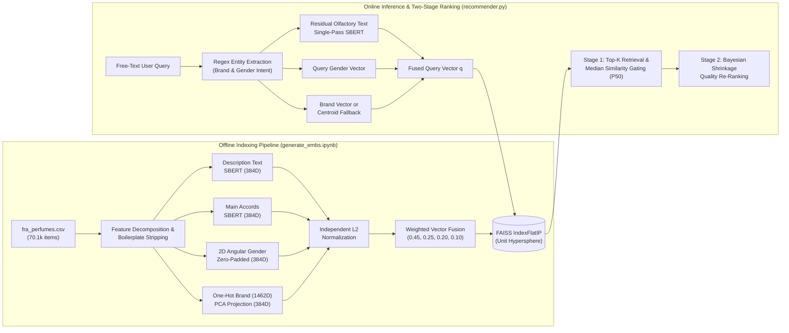

# Multi-Modal Semantic Fragrance Recommender Engine

A content-based, multi-modal information retrieval and two-stage ranking system for fragrance discovery across **$70,103$ perfumes** ($1,462$ unique brands). The system combines dense Transformer embeddings (`all-MiniLM-L6-v2`), Principal Component Analysis (PCA) for high-cardinality categorical compression, geometric gender encoding, exact inner-product search via **FAISS**, and **Empirical Bayes (Bayesian shrinkage)** re-ranking.

---

## 1. System Architecture Overview



---

## 2. Feature Engineering & Representation Learning

A naive approach to text-based product recommendation concatenates all metadata fields into a single string before embedding. However, single-string concatenation allows high-frequency tokens (such as brand names or gender boilerplate) to dominate attention weights and prevents explicit control over modality importance.

Instead, we decompose each item $i \in \{1, \dots, N\}$ into four semantically independent feature representations, each mapped to $\mathbb{R}^{384}$ and projected onto the unit hypersphere ($\|\hat{\mathbf{e}}\|_2 = 1$).

### 2.1 Olfactory Narrative (`Description`) & De-biasing
Fragrantica descriptions follow a standardized template where the opening sentence repeats the perfume name, house, fragrance family, and target gender (e.g., *"9pm by Afnan is an Amber Vanilla fragrance for men."*).
* **Signal Isolation**: We strip the opening sentence during preprocessing so that the sentence encoder focuses exclusively on the top, heart, and base notes as well as the olfactory narrative, eliminating cross-modality leakage into the brand and gender channels.
* **Encoder**: Encoded via `sentence-transformers/all-MiniLM-L6-v2` into $\hat{\mathbf{e}}_{i,\text{desc}} \in \mathbb{R}^{384}$.

### 2.2 Structured Olfactory Taxonomy (`Main Accords`)
High-level scent descriptors (e.g., `woody`, `citrus`, `warm spicy`, `amber`) are normalized and encoded separately via `all-MiniLM-L6-v2` into $\hat{\mathbf{e}}_{i,\text{accord}} \in \mathbb{R}^{384}$. Keeping accords separate from free-text descriptions prevents verbose storytelling in long descriptions from drowning out primary olfactory families.

### 2.3 Angular Gender Geometry (`Gender`)
Rather than treating gender as a discrete hard filter—which fails when unisex fragrances are appropriate for gendered queries—we encode gender on the 2D unit circle in the positive quadrant before zero-padding to $\mathbb{R}^{384}$:

$$\mathbf{g}_{\text{men}} = \begin{bmatrix} 1 \\ 0 \end{bmatrix}, \quad \mathbf{g}_{\text{women}} = \begin{bmatrix} 0 \\ 1 \end{bmatrix}, \quad \mathbf{g}_{\text{unisex}} = \begin{bmatrix} 1/\sqrt{2} \\ 1/\sqrt{2} \end{bmatrix}$$

This geometry yields the following pairwise inner products (cosine similarities):
* $\langle \mathbf{g}_{\text{men}}, \mathbf{g}_{\text{women}} \rangle = 0.0$ (orthogonal separation between opposite binary genders)
* $\langle \mathbf{g}_{\text{men}}, \mathbf{g}_{\text{unisex}} \rangle = \langle \mathbf{g}_{\text{women}}, \mathbf{g}_{\text{unisex}} \rangle = \frac{\sqrt{2}}{2} \approx 0.7071$ ($45^\circ$ angular bisector)
* $\langle \mathbf{g}_{k}, \mathbf{g}_{k} \rangle = 1.0$ (exact gender match)

### 2.4 High-Cardinality Brand Compression (`Brand`)
With $M = 1,462$ unique brands across $N = 70,103$ items, the one-hot brand indicator matrix $\mathbf{B} \in \{0, 1\}^{N \times M}$ is sparse and dimensionally incompatible with the 384D dense embeddings.
* **Offline**: We fit a truncated Principal Component Analysis (PCA) transformation $\mathbf{B}_{\text{PCA}} = (\mathbf{B} - \boldsymbol{\mu})\mathbf{W}_{384} \in \mathbb{R}^{N \times 384}$, followed by row-wise L2 normalization to obtain $\hat{\mathbf{e}}_{i,\text{brand}}$.
* **Online Centroid Fallback**: When a user query does not specify a brand, injecting a zero vector would alter the norm ratio of the fused query vector. Instead, we substitute the L2-normalized empirical brand centroid:
  $$\bar{\mathbf{e}}_{\text{brand}} = \frac{\frac{1}{N}\sum_{i=1}^{N} \hat{\mathbf{e}}_{i,\text{brand}}}{\left\|\frac{1}{N}\sum_{i=1}^{N} \hat{\mathbf{e}}_{i,\text{brand}}\right\|_2}$$

---

## 3. Multi-Modal Fusion & Vector Indexing

Because each modality is independently L2-normalized ($\|\hat{\mathbf{e}}_{i,m}\|_2 = 1$), we construct a single fused representation via a convex linear combination followed by global L2 normalization:

$$\tilde{\mathbf{e}}_i = w_{\text{desc}}\,\hat{\mathbf{e}}_{i,\text{desc}} + w_{\text{accord}}\,\hat{\mathbf{e}}_{i,\text{accord}} + w_{\text{gender}}\,\hat{\mathbf{e}}_{i,\text{gender}} + w_{\text{brand}}\,\hat{\mathbf{e}}_{i,\text{brand}}$$

$$\mathbf{e}_i = \frac{\tilde{\mathbf{e}}_i}{\|\tilde{\mathbf{e}}_i\|_2} \in \mathbb{R}^{384}$$

| Modality | Weight ($w_m$) | Design Rationale |
| :--- | :---: | :--- |
| **Description** ($\hat{\mathbf{e}}_{\text{desc}}$) | `0.45` | Primary semantic driver: captures specific top/middle/base note combinations and mood. |
| **Main Accords** ($\hat{\mathbf{e}}_{\text{accord}}$) | `0.25` | Secondary olfactory anchor: enforces macro-level fragrance family consistency. |
| **Gender** ($\hat{\mathbf{e}}_{\text{gender}}$) | `0.20` | Soft demographic constraint: penalizes opposite-gender items while keeping unisex viable. |
| **Brand** ($\hat{\mathbf{e}}_{\text{brand}}$) | `0.10` | House affinity boost when a brand is explicitly queried; neutral centroid otherwise. |

### Complexity Reduction via Pre-Fusion
By fusing the normalized vectors offline and indexing $\mathbf{e}_i$ in `faiss.IndexFlatIP(384)`, online retrieval requires **one** inner-product search over $\mathbb{R}^{384}$ rather than four separate similarity searches and score aggregations, achieving sub-5ms exact search latency across all $70,103$ items on CPU.

---

## 4. Query Understanding & Two-Stage Ranking

### 4.1 Deterministic Query De-noising
Given a raw user query $q_{\text{raw}}$ (e.g., *"Warm vanilla, cinnamon and amber winter scent for men"*):
1. **Brand Extraction**: Word-boundary regex (`\b`) evaluated in descending order of brand length extracts explicit brand mentions without matching substrings inside common words.
2. **Gender Intent Detection**: Word-boundary regex maps `{men, man, male} -> [1, 0]`, `{women, woman, female} -> [0, 1]`, and `{unisex} -> [0.707, 0.707]` (defaulting to unisex/neutral when omitted or when both genders are present).
3. **Residual Olfactory Encoding**: Detected brand and gender tokens are stripped from $q_{\text{raw}}$ before passing the residual text through `all-MiniLM-L6-v2` in a single forward pass for both description and accord projections.

### 4.2 Stage 1: Semantic Retrieval & Dynamic Quantile Gating
FAISS retrieves the top-$K$ candidates ranked by cosine similarity $S_i = \langle \mathbf{q}, \mathbf{e}_i \rangle$. To prevent high-rated but semantically mediocre items from rising to the top during re-ranking, we apply a dynamic 50th-percentile similarity gate:

$$\mathcal{C}_{\text{filtered}} = \left\{ i \in \mathcal{C}_{K} \;\middle|\; S_i \ge \text{Median}\left(\{S_j\}_{j \in \mathcal{C}_{K}}\right) \right\}$$

### 4.3 Stage 2: Empirical Bayes (Shrinkage) Quality Re-Ranking
Raw mean ratings $R_i \in [1, 5]$ suffer from high variance for low-volume items (e.g., a $5.0$ average from $v_i = 2$ ratings outranking a $4.65$ average from $v_i = 3,500$ ratings). We compute a **Bayesian Weighted Rating** $W_i$ that shrinks noisy estimates toward the global prior mean $C$:

$$W_i = \frac{v_i}{v_i + m} R_i + \frac{m}{v_i + m} C$$

where:
* $R_i$ = item mean rating (`Rating Value`)
* $v_i$ = item vote count (`Rating Count`)
* $C = \frac{1}{N}\sum_{j=1}^N R_j$ = global mean rating across the catalog
* $m = Q_{0.75}(v)$ = 75th percentile of vote counts across the catalog (minimum votes required for full credibility weight)

Surviving candidates in $\mathcal{C}_{\text{filtered}}$ are sorted by $W_i$ descending.

---

## 5. Repository Structure

```text
perfume_recommender/
├── generate_embs.ipynb   # Offline ETL, Bayesian rating computation, SBERT & PCA embedding generation
├── recommender.ipynb     # Interactive experimentation notebook for late fusion, FAISS & query testing
├── recommender.py        # Production inference module (FAISS index construction, query parser, recommender)
├── app.py                # Streamlit web/kiosk interface with caching, query diagnostics & card/table views
├── fra_perfumes.csv      # Raw Fragrantica dataset (~70.1k fragrances)
├── data.pkl              # Cleaned DataFrame aligned 1:1 with embedding indices (0..N-1)
├── desc_embs.npy         # L2-normalized SBERT description embeddings (70103, 384) float32
├── accord_embs.npy       # L2-normalized SBERT main accord embeddings (70103, 384) float32
├── gender_embss.npy      # L2-normalized zero-padded 2D gender embeddings (70103, 384) float32
└── brand_embs.npy        # L2-normalized PCA brand embeddings (70103, 384) float32
```

---

## 6. Quickstart & Usage

### Prerequisites
```bash
pip install numpy pandas scikit-learn sentence-transformers faiss-cpu streamlit streamlit-autorefresh
```

### 1. Recomputing Embeddings (Optional)
If `data.pkl` and the `.npy` artifacts are already present in the root directory, you can skip directly to inference. To regenerate all artifacts from `fra_perfumes.csv`, execute all cells in:
```bash
jupyter notebook generate_embs.ipynb
```

### 2. Python API Usage
```python
from recommender import recommend

results_df, raw_results = recommend(
    "Warm vanilla, cinnamon, amber and sweet spicy winter scent for men",
    top_k=10,
)
print(results_df[["Name", "Brand", "Gender", "Main Accords", "Score", "Distance"]])
```

### 3. Launching the Interactive Streamlit App
```bash
streamlit run app.py
```
